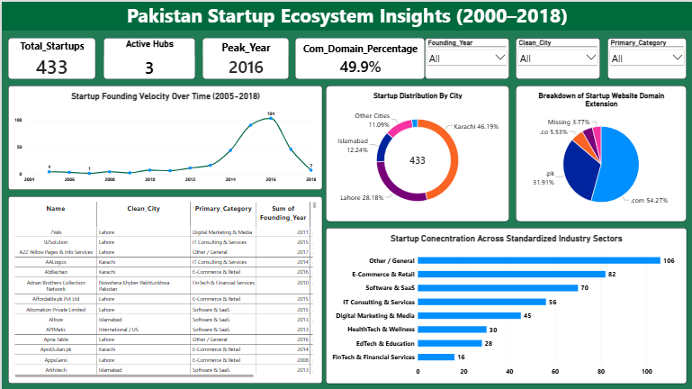

# Pakistan Startup Ecosystem Analysis & Insights (2000–2018)

An end-to-end data analytics portfolio project examining the growth trajectory, geographic concentration, industry distribution, and web strategies of startups across Pakistan.

---
## 🖥️ Dashboard Preview
An interactive executive dashboard built in Power BI visualizing key metrics, geographic hubs, founding velocity, and sector saturation:


---

## 🚀 Project Overview
The **Pakistan Startup Ecosystem Analysis** is a comprehensive data analytics portfolio project designed to evaluate and visualize the structural characteristics of startups founded across Pakistan over nearly two decades (2000–2018). 

Driven by rapid mobile broadband expansion, infrastructure improvements, and digital transformation initiatives, the Pakistani startup ecosystem has matured significantly. This project ingests raw census records, cleans and standardizes messy text fields, engineers high-value analytical features (such as macro-industry categories, company ages, and domain extensions), and presents actionable insights through both an interactive Power BI dashboard and an automated Python exploratory data analysis pipeline. 

### Core Objectives
* **Quantify Geographic Hub Concentration:** Measure the distribution of startups across major urban centers (Karachi, Lahore, Islamabad) versus tier-2 cities.
* **Track Founding Velocity & Growth Spikes:** Identify historical growth phases and pinpoint peak startup formation years.
* **Analyze Digital Presence & Web Strategies:** Assess domain extension preferences (`.com` vs. country-code `.pk`/`.com.pk`) to understand domestic versus international market ambitions.
* **Map Industry Sector Saturation:** Categorize hundreds of fragmented sub-industries into standardized macro-sectors (e.g., E-Commerce & Retail, Software & SaaS, IT Consulting) and compare saturation across regional hubs.

---

## 🔗 Project Links
* **GitHub Repository:** [Pakistan Startup Ecosystem Analysis on GitHub]([https://github.com/your-username/pakistan-startup-ecosystem-analysis](https://github.com/Hafiz-Rehman123/Pakistan-Startup-Ecosystem-Analysis-Insights-2000-2018-)) *(Replace with your live repository link)*
* **Interactive Dashboard:** Hosted via Power BI Service / Downloadable `.pbix` file located in the `dashboard/` directory of this repository.

---

## 🛠️ Tech Stack & Tools
* **Data Processing & Wrangling:** Python (`Pandas`, `NumPy`, `RegEx`)
* **Text Mining & Natural Language Processing:** Python (`WordCloud`, `NLTK` Stopwords)
* **Data Visualization & Dashboarding:** Power BI Desktop (`DAX`, Interactive Slicers, Bookmarks)
* **Version Control:** Git & GitHub

---

## 📊 Key Findings & Business Insights
1. **Geographic Concentration:** **Karachi** serves as the primary commercial hub representing **46.2%** of all recorded startups, followed by **Lahore** (28.2%) and **Islamabad** (12.2%). Together, these top three cities account for over **86%** of the country's startup activity.
2. **Growth Velocity & Peak Years:** Startup creation surged dramatically between 2014 and 2017, reaching an all-time high in **2016** with **104 startups** founded, driven by widespread mobile broadband expansion.
3. **Web Domain Strategy:** Nearly **49.9%** of startups utilize global `.com` domains—indicating outward-looking or international market ambitions—while **33.5%** operate on local country-code extensions (`.pk` and `.com.pk`).
4. **Sector Saturation:** **E-Commerce & Retail** and **Software & SaaS** represent the largest defined technology sectors across major urban centers.

---

## 📁 Repository Structure
```text
pakistan-startup-ecosystem-analysis/
│
├── data/
│   ├── pakistan-startup-census.csv             # Raw dataset
│   └── pakistan_startup_census_featured.csv    # Cleaned & featured dataset
│
├── notebooks/
│   └── pakistan_startup_analysis.ipynb         # Python end-to-end code notebook
│
├── dashboard/
│   ├── pakistan_startup_dashboard.pbix         # Power BI project file
│   └── dashboard_preview.png                   # High-res screenshot of dashboard
│
└── README.md                                   # Project report & documentation
